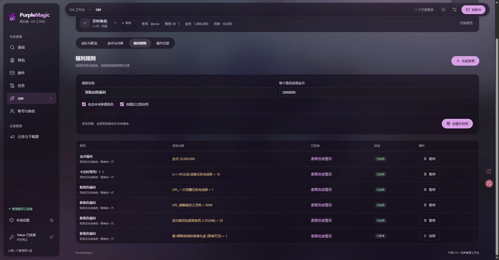

# 福利规则：把一次发奖变成持续运营规则

PurpleMagic 将奖励内容、受众资格和领取记录保存成一条长期规则。管理员创建并启用后，外部 GMService 的定时器自动处理符合条件的角色；关闭页面后仍继续运行。勾选“包含未来新建角色”后，后来加入的角色也会获得同一份福利。

例如创建“冒险启程福利”，每角色发放 2,000,000 金币，并选择覆盖未来角色。现有角色进入后台扫描，新建角色在后续扫描中加入；同一角色已经获得这条规则的奖励后，重复扫描只读取领取记录。规则处于暂停期间不启动新的投递，恢复后继续处理尚未领取的合格角色。

## 三个相互独立的决定

| 决定 | 行为 |
| --- | --- |
| 奖励内容 | 金币或一个物品类型及其数量；物品按批准 PVF 的定义构造。多种物品分别建立规则 |
| 领取范围 | 领域 API 支持每角色一次与每账号一次。当前金币快捷表单是每角色一次；账号级规则沿用单一收件角色选择策略 |
| 时间受众 | 首次自动启用时保存现有角色截止时间；“未来角色”选项独立决定后续创建角色是否加入 |

选择账号发送一次邮件会展开为该账号的全部现有角色；“每账号一次”的福利规则则按账号永久去重。这两个功能的范围不同。

## 为什么能够反复扫描

每条规则有固定 ID，数据库记录“这条规则对这个账号/角色已经发过”。投递邮件、附件和领取回执在同一事务中完成。断网、重试、服务重启后继续读取同一套记录；删除已收取的邮件不会删除领取回执。

暂停与恢复保留原规则 ID、首次启用时间、现有角色截止时间和全部回执。只覆盖现有角色的规则，恢复时仍沿用原截止时间；需要扩大受众时创建新的明确规则。已经启用的历史规则也不会因为打开新版页面而自动扩大受众。

调度在外部管理服务，游戏侧每次处理最多 5 个账号，单批邮件最多 10 人。完整 PVF 与检索索引留在外部，游戏侧执行有界事务和准入检查。页面查看进度，后台负责推进。

## 适合的场景

- 长期新人礼包：现有与未来角色持续覆盖。
- 活动补偿：首次启用时固定现有受众，保留可查的发放记录。
- 测试服基础资源：暂停或恢复发放，不需要手工重新整理未领名单。

当前规则按账号或角色终身一次，没有每日重置、周期领取或活动日历。新建另一条规则会产生另一份领取资格。PVF 更新需要验证奖励定义并保持原规则和回执，不通过重建索引来重置领取次数。

实现与验证入口：[规则和受众](../gateway/internal/modules/dnf/testbenefits/campaigns.go)、[发放事务](../gateway/internal/modules/dnf/testbenefits/operations.go)、[自动福利与恢复契约](GM_FEEDBACK_RULES.md)、[外部调度](GM_EXTERNAL_SERVICES.md)。

## English overview

A benefit rule stores an immutable reward, recipient eligibility and permanent delivery receipts. Once enabled, the external service scans eligible characters in bounded batches, even when the browser is closed. Operators can include future characters or keep the original existing-character cutoff.

Rules support once per character or once per account at the domain API level; the console's quick gold form is once per character. Mail/attachments and the receipt commit together. Retries, restarts, deleted mail, pause/resume and index rebuilds preserve the original receipt identity. This turns a manual mailing task into a persistent onboarding or compensation policy. Current rules are lifetime-once per identity, not daily or recurring rewards.
